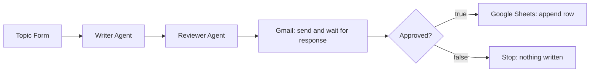

# LinkedIn Post Approval Workflow (n8n)

An n8n automation that drafts LinkedIn posts with AI, sends them to you for approval, and saves **only the posts you approve** to Google Sheets. Nothing is stored without a human decision.

Built as the Week 4, Day 2 assignment of the [Social Eagle](https://socialeagle.ai) *learn. build. operate* program.

---

## Overview

| | |
|---|---|
| **Problem** | AI-written posts should never be filed or published without your say-so. |
| **Solution** | A two-agent pipeline (Writer, then Reviewer) followed by a human approval gate. The run pauses until you click **Approve** or **Reject**. |
| **Outcome** | Approved posts land in a Google Sheet as `Date \| Topic \| Final Post \| Status`. Rejected posts are dropped. |
| **Stack** | n8n, OpenAI chat models, Gmail, Google Sheets |

## Architecture



## How it works

| # | Node | Type | What it does |
|---|------|------|--------------|
| 1 | **Topic Form** | Form Trigger | Web form with one required field, `Topic`. |
| 2 | **Writer Agent** | AI Agent + chat model | Drafts the post: hook in line one, 120-150 words, one call to action, max 3 hashtags. |
| 3 | **Reviewer Agent** | AI Agent + separate chat model | Judges the draft against a written rubric, rewrites the weakest part, and returns the final post only. |
| 4 | **Send Post for Approval** | Gmail (*Send message and wait for response*) | Emails the final post with **Approve** and **Reject** buttons. The run pauses, with a 1-day wait limit. |
| 5 | **Approved?** | IF | Checks `{{ $json.data.approved }}` is `true`. |
| 6 | **Save Approved Post** | Google Sheets (*Append Row*) | On the true branch only, writes the row. |

## Design decisions

- **Two separate agents, not one prompt.** The Writer creates; the Reviewer only judges and improves. Splitting the roles keeps each prompt focused and the output better.
- **The Reviewer has explicit standards.** A reviewer can only improve what it is allowed to judge, so it scores against a rubric: hook, clarity, CTA, length (120-150 words), hashtags (max 3) and tone.
- **The Reviewer returns the rewritten post, not feedback.** The approval email and the sheet get clean, ready-to-use text.
- **Reject means drop.** A rejected post writes nothing. To keep a record of rejections, add a second Google Sheets node on the false branch with `Status = Rejected`.
- **Human-in-the-loop by design.** The Gmail *send and wait* operation pauses the execution, so no row can be written without an explicit approval.
- **Secrets stay out of the workflow.** All credentials live in the n8n credential store; the exported JSON contains none.

## Prerequisites

- An n8n instance (cloud or self-hosted)
- An OpenAI API key (or any chat model supported by n8n)
- A Google Cloud project with the **Gmail API** and **Google Sheets API** enabled, and OAuth credentials
- A Google Sheet with the headers: `Date | Topic | Final Post | Status`

## Setup

1. In n8n, go to **Workflows > Import from file** and select `LinkedIn Post Approval.json`.
2. Add credentials in n8n: **OpenAI**, **Gmail (OAuth2)** and **Google Sheets (OAuth2)**.
3. Open **Send Post for Approval** and enter your own email address in **To**.
4. Open **Save Approved Post** and select your Google Sheet and tab.
5. Click **Execute workflow**, open the form, and submit a topic.
6. Check your inbox, click **Approve**, and confirm the row appears in the sheet.
7. Run it again and click **Reject** to confirm nothing is written.
8. When you are happy, **publish** the workflow to use the production form URL.

## Prompts

**Writer Agent**

```text
Write a LinkedIn post about: {{ $json.Topic }}
Hook in line one, 120-150 words, one call to action,
max 3 hashtags. Return the post only.
```

**Reviewer Agent** (user message)

```text
Review the LinkedIn post below against your standards. Score it out of 10
on hook, clarity and CTA, then rewrite its weakest part. Return the final
post only.

POST:
{{ $json.output }}
```

The Reviewer's system message holds the rubric (hook, clarity, CTA, length, hashtags, tone) and instructs it to output only the final post, with no scores or commentary.

## Example run

```text
1. Submit topic in the form          ->  "Remote work"
2. Writer Agent drafts the post
3. Reviewer Agent returns the final version
4. Email arrives with Approve / Reject; the run waits
5. Click Approve                     ->  2026-10-01 | Remote work | <final post> | Approved
   Click Reject                      ->  nothing is written
```

## Troubleshooting

| Issue | Fix |
|-------|-----|
| `Bad request: 'temperature' is not supported with this model` | Reasoning models such as `gpt-5-mini` reject the temperature setting. Remove it from the chat model options, or use a non-reasoning model. |
| Run never resumes after the email | Check the wait limit (1 day) and that the Gmail credential is authorized. Test executions only resume while the editor is waiting. |
| Sheet row is empty or misaligned | Confirm the headers match exactly: `Date`, `Topic`, `Final Post`, `Status`. |
| Form field not found in the prompt | The expression must match your field label. If you rename the field, update `{{ $json.Topic }}` in the Writer Agent. |

## Repository contents

```text
.
├── LinkedIn Post Approval.json   # exported n8n workflow
├── README.md
└── screenshots/                  # canvas, approval email, saved sheet row
```

## Possible extensions

- Log rejected posts with `Status = Rejected`
- Add a revision loop: Reject with comments triggers a rewrite
- Auto-publish approved posts to LinkedIn
- Add a Slack or WhatsApp approval channel

## Author

Built by **Fathima**
